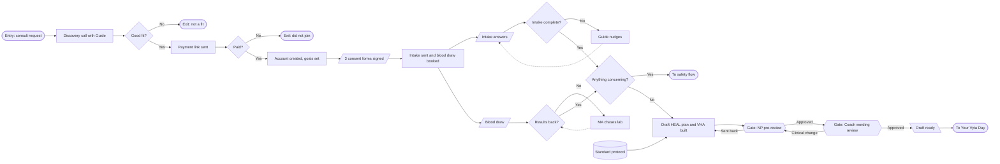
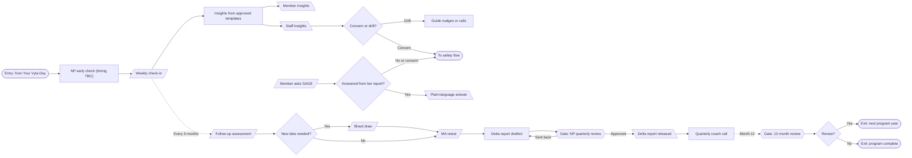
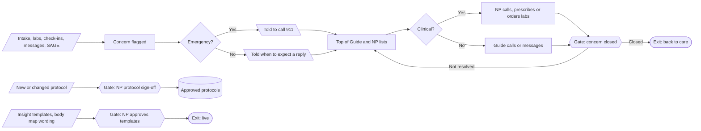

# App Flow

The source of truth is the FigJam board: https://www.figma.com/board/FuyLYsGWMqLUlLyKeX1doS
The Mermaid below mirrors it so Claude Code can read it.

Shapes: `([ ])` entry/exit · `[/ /]` input · `[\ \]` output · `{ }` decision · `{{ }}` gate (a person approves) · `[( )]` data.

## 1. Join, intake and labs

## 2. Your Vyta Day

```mermaid
flowchart LR
  arrive(["Entry: member arrives"]) --> inbody[/"InBody"/] --> funct[/"Functional tests"/] --> shape[/"ShapeScale"/] --> vo2[/"VO2 max"/]
  shape --> npSections["NP reviews finished sections"]
  vo2 --> concern{"Anything concerning?"}
  concern -->|Yes| toSafety(["To safety flow"])
  concern -->|No| complete{{"Gate: completeness check"}}
  complete -->|Missing| collect["Collect or skip with reason"] -.-> complete
  complete -->|All in| updated{"Draft updated in time?"}
  npSections --> updated
  vo2 --> wait["Member: coach session"]
  updated -->|Yes| final{{"Gate: NP final review"}}
  updated -->|No| manual["Fallback: NP finalises manually"] --> final
  final --> results["Results conversation"]
  wait --> results
  results --> choices[/"Her choices and consents"/] --> release{{"Gate: approve and release"}}
  release -->|Not ready| final
  release -->|Approved| out[\"Report and plan in her app"\] --> leave(["Exit: leaves with report"])
  release -->|Approved| orders["Order checklist"] --> placed{"All placed?"}
  placed -->|No| place["NP or MA places order"] -.-> placed
  leave --> nextDay["Guide call next day"] --> toOngoing(["To ongoing care"])
```

## 3. Ongoing care, quarterly and renewal

## 4. Safety and setup gates

